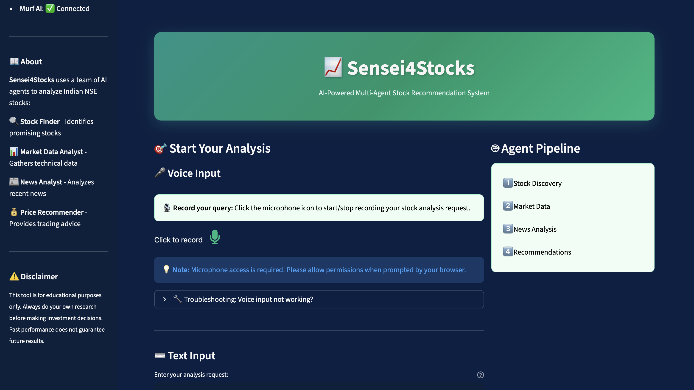
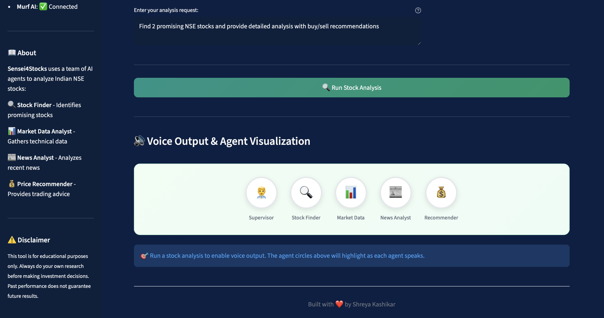

# 📈 Sensei4Stocks - Multi-Agent debate for Stocks Recommendation

This project demonstrates how LLM-driven agents can collaborate to fetch data and generate guidance for the Indian Stock Market (NSE).


---

## 🚀 Live Demo

Deploy your own instance using the instructions below!

### Demo Video

<a href="https://drive.google.com/file/d/1Ps0beFcaZu-vaujHhgy7HTDY0wkZA-od/view?usp=sharing" target="_blank"> Sensei4Stocks </a>

### Screenshot




---

## 🧩 Overview

The system is built around four specialized AI agents:

| Agent | Role |
|-------|------|
| 🔍 **Stock Finder** | Identifies promising NSE-listed stocks based on recent performance, news buzz, volume, or technical strength |
| 📊 **Market Data Analyst** | Gathers technical data including price, volume, trends, RSI, and moving averages |
| 📰 **News Analyst** | Analyzes recent news articles and classifies sentiment as positive, negative, or neutral |
| 💰 **Price Recommender** | Provides actionable Buy/Sell/Hold recommendations with target prices |

A **Supervisor agent** orchestrates the workflow between these agents using LangGraph.

### 🧠 Models & APIs

| Component | Default | Optional |
|-----------|---------|----------|
| LLM (all agents + supervisor) | Meta Llama 3.3 70B via NVIDIA | **Meta Muse Spark** via the Meta Model API (`LLM_PROVIDER=meta`) |
| Speech-to-Text | **Meta Muse Voice Transcribe** (Meta Model API) | - |
| Text-to-Speech | **Meta MMS-TTS** (open source, runs locally, free) | Murf AI (`TTS_PROVIDER=murf`) |

> Meta does not currently offer a text-to-speech API (Muse Voice Transcribe is speech-to-text only). MMS-TTS has a single base voice, so each agent gets its own voice by varying pitch, speed, expressiveness and tone (see `MMS_VOICE_PROFILES` in `voice_generator.py`). Murf AI is supported for higher-quality voices.

---

## ✨ Features

- **Professional Streamlit UI** - Clean, modern interface for stock analysis
- **Multi-Agent AI System** - Four specialized agents working together
- **🔌 MCP Tool Integration** - Agents fetch live NSE prices, data and news through the Bright Data MCP server (via langchain-mcp-adapters)
- **Real-time Progress** - Watch agents work in real-time
- **Quick Analysis Options** - Pre-built queries for common use cases
- **🎤 Speech-to-Text** - Voice input using Meta's Muse Voice Transcribe for hands-free queries
- **🔊 Voice Output** - Multi-agent debate style audio summaries with a distinct voice per agent, using Meta's open-source MMS-TTS (free) or Murf AI (optional)
- **Responsive Design** - Works on desktop and mobile

---

## 🛠️ Installation


### Local Setup

1. **Clone the repository**
   ```bash
   git clone https://github.com/shreyakash24/Sensei4Stocks.git
   cd Sensei4Stocks
   ```

2. **Create a virtual environment**
   ```bash
   python -m venv venv
   source venv/bin/activate  # On Windows: venv\Scripts\activate
   ```

3. **Install dependencies**
   ```bash
   pip install -r requirements.txt
   ```

4. **Set up environment variables**
   
   Create a `.env` file in the project root:
   ```env
   # Required
   NVIDIA_API_KEY=your_nvidia_api_key
   BRIGHT_DATA_API_TOKEN=your_bright_data_token
   
   # Meta Model API key - needed for voice input (Muse Voice Transcribe)
   # and for the Meta LLM option. Typing queries works without it.
   MODEL_API_KEY=your_meta_model_api_key
   
   # Optional - use Meta Muse Spark instead of NVIDIA as the LLM
   # (NVIDIA_API_KEY is not needed in this mode)
   # LLM_PROVIDER=meta
   # META_MODEL=muse-spark-1.3
   
   # Optional - voice output provider: mms (default, free) or murf
   # TTS_PROVIDER=murf
   # MURF_API_KEY=your_murf_api_key
   
   # Optional - Bright Data zones
   WEB_UNLOCKER_ZONE=unblocker
   BROWSER_ZONE=scraping_browser
   ```

5. **Run the application**
   ```bash
   streamlit run app.py
   ```

6. **Open your browser** at `http://localhost:8501`

---

## 🔑 Environment Variables

### Required

| Variable | Description |
|----------|-------------|
| `NVIDIA_API_KEY` | Your NVIDIA API key for LLM access (not needed when `LLM_PROVIDER=meta`) |
| `BRIGHT_DATA_API_TOKEN` | Bright Data API token for web scraping |

### Optional - Meta Model API

| Variable | Default | Description |
|----------|---------|-------------|
| `MODEL_API_KEY` | - | Meta Model API key. Required for voice input and when `LLM_PROVIDER=meta` |
| `LLM_PROVIDER` | nvidia | `nvidia` (Llama 3.3 70B) or `meta` (Muse Spark) |
| `META_MODEL` | muse-spark-1.3 | Meta model used when `LLM_PROVIDER=meta` (e.g. `muse-spark-1.3-contributor` for the cheaper tier) |

### Optional - Voice Output

| Variable | Default | Description |
|----------|---------|-------------|
| `TTS_PROVIDER` | mms | `mms` (Meta MMS-TTS, free, local) or `murf` (Murf AI) |
| `MMS_TTS_MODEL` | facebook/mms-tts-eng | Hugging Face model ID for MMS-TTS (downloaded on first use) |

### Optional - Bright Data Configuration

| Variable | Default | Description |
|----------|---------|-------------|
| `WEB_UNLOCKER_ZONE` | unblocker | Web Unlocker zone name |
| `BROWSER_ZONE` | scraping_browser | Browser zone name |

### Optional - Murf AI (only when `TTS_PROVIDER=murf`)

| Variable | Default | Description |
|----------|---------|-------------|
| `MURF_API_KEY` | - | Your Murf AI API key |
| `MURF_VOICE_STOCK_FINDER` | Matthew | Voice for Stock Finder Agent |
| `MURF_VOICE_MARKET_DATA` | Julia | Voice for Market Data Agent |
| `MURF_VOICE_NEWS_ANALYST` | Ken | Voice for News Analyst Agent |
| `MURF_VOICE_RECOMMENDER` | Ruby | Voice for Price Recommender Agent |
| `MURF_VOICE_SUPERVISOR` | Emily | Voice for Supervisor |
| `MURF_MODEL` | FALCON | Murf AI model to use |
| `MURF_LOCALE` | en-US | Language/locale setting |
| `MURF_SAMPLE_RATE` | 24000 | Audio sample rate |

---

## ⚠️ Disclaimer

The stock recommendations provided by the AI agents should not be considered as final advice.

- Always do your own research before making investment decisions
- Past performance does not guarantee future results
- Consult with a qualified financial advisor for investment decisions

---